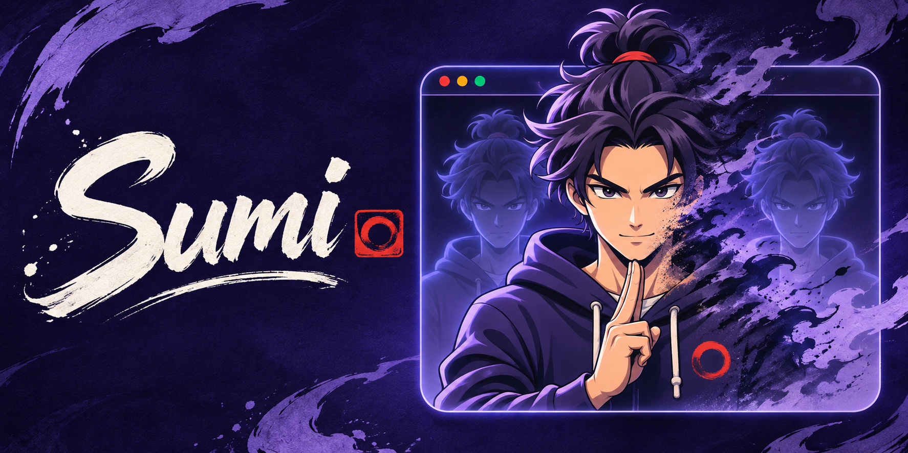

# Sumi

Suma da webcam com um gesto e reapareça quando quiser. Teleporte, kawarimi, clones
de sombra, onda e esfera de energia, poeira, pixels, saída de desenho e portal, com
sons, para suas chamadas de vídeo.

O nome vem do português “(eu) sumi” e da tinta japonesa *sumi*.

**macOS (Apple Silicon) e Windows x64 · Processamento local · Sem gravação de áudio · Sem APIs pagas**

[Baixar a versão 0.7.0](https://github.com/LyonMuller/sumi/releases/tag/v0.7.0) ·
[Como usar](COMO_USAR.md) · [Privacidade](PRIVACY.md)

> **Versão 0.7.0 · atualizações dentro do app, contagem do fundo na câmera e pausa no
> estalo.** O app do Mac está pronto para baixar e, a partir desta versão, se atualiza
> sozinho; no Windows, rode pelos fontes por enquanto. Teste a prévia antes de
> usar em uma reunião importante.

## Baixar e abrir

### macOS

Requer um Mac com Apple Silicon (M1 ou posterior) e macOS 15 ou superior.

1. Baixe o arquivo `.dmg` da versão mais recente em
   [Releases](https://github.com/LyonMuller/sumi/releases/latest).
2. Abra o `.dmg` e arraste o **Sumi** para a pasta **Aplicativos**.
3. Abra o Sumi pela pasta Aplicativos. Na primeira vez, o macOS bloqueia a abertura,
   porque o app ainda não é notarizado pela Apple. Vá em **Ajustes do Sistema ›
   Privacidade e Segurança**, role até o aviso sobre o Sumi e clique em
   **Abrir mesmo assim**. Confirme com sua senha ou Touch ID. Isso só é preciso uma vez.
4. Permita o acesso à **câmera** quando o Sumi pedir. Se negou sem querer, ative em
   **Ajustes do Sistema › Privacidade e Segurança › Câmera**.

Você não precisa desativar nenhuma proteção do macOS, nem instalar Python ou baixar o
projeto. O app inclui o necessário. A tela de boas-vindas do Sumi guia o resto.

### Windows

Os executáveis do Windows (instalador e arquivo único) desta versão ainda não foram
gerados. Por enquanto, rode o Sumi pelos fontes seguindo [DESENVOLVIMENTO.md](DESENVOLVIMENTO.md)
ou gere o instalador e o executável único com [DISTRIBUIR.md](DISTRIBUIR.md).

## Preparar uma vez para chamadas

Instale o **[OBS Studio pelo site oficial](https://obsproject.com/download)** para
obter a câmera virtual. Esse componente ainda é necessário para enviar o resultado
às chamadas. Você não precisa manter o OBS aberto.

- **macOS:** abra o OBS uma vez, clique em **Iniciar Câmera Virtual** e aprove a
  extensão em **Ajustes do Sistema › Geral › Itens de Início e Extensões**. A tela
  de boas-vindas do Sumi detecta o OBS e mostra o que falta.
- **Windows:** no Sumi, abra **Configurar → Meet → Preparar vídeo para o Meet**.

Na reunião, escolha **OBS Virtual Camera** como câmera e desative os efeitos de
fundo do serviço. Seu microfone continua sendo o normal da chamada.

A extensão de navegador é **opcional**: serve apenas para sair automaticamente
do Meet. Não é necessária para os efeitos aparecerem na chamada.

## Seu primeiro desaparecimento

1. Escolha sua webcam (macOS: Ajustes ⌘, › Câmera; Windows: **Configurar → Câmera**)
   e clique em **Iniciar câmera**.
2. Clique em **Capturar fundo** e saia do enquadramento durante a contagem (5 s, ajustável).
3. Confira a imagem vazia e clique em **Confirmar fundo vazio**.
4. Volte, escolha um efeito e clique em **Ativar efeito** ou faça o gesto indicado.
5. Use **Reaparecer** para voltar. **Restaurar** interrompe o efeito: F8 no Windows;
   no Mac, fn+F8 ou ⌃⌥R, mesmo com outro app em primeiro plano.

O fundo **Estático** é o padrão recomendado. Mantenha a câmera fixa e refaça a
captura ao mudar a posição ou a iluminação. A opção **Em movimento** é experimental:
atualiza partes visíveis do cenário, mas pode apresentar falhas e artefatos.
A câmera não enxerga o que está atrás de você; a captura inicial continua necessária.

## Efeitos e gestos

Clique em **Como fazer**, no aplicativo, para ver a ilustração e os passos ampliados.

| Gesto | Efeito | Como ativar |
|:---:|---|---|
|  | **Teleporte anime / Suave** | Indicador e médio juntos na testa; mantenha até completar a barra. |
|  | **Kawarimi · tronco** | Uma mão, indicador e médio juntos para cima, outros dedos dobrados. Uma explosão de fumaça e um tronco fica no seu lugar. Sem tocar a testa. |
|  | **Clones de sombra** | Cruze indicador e médio das duas mãos à frente do peito; mantenha até completar a barra. Os clones ficam. O selo de uma mão chama mais clones (até 8) e cruzar os dedos de novo dispensa todos. |
|  | **Virar poeira** | Encoste polegar e médio brevemente, depois faça o movimento de estalar. |
|  | **Saída digital** | Encoste polegar e indicador por um instante; depois abra a pinça. |
|  | **Saída de cena** | Mostre uma palma aberta e mantenha parada até completar a barra. Não precisa acenar. |
|  | **Portal** | Duas palmas abertas, uma de cada lado do rosto; mantenha até completar a barra. |
|  | **Instantâneo** | Use Ativar efeito ou Reaparecer. |
|  | **Onda de energia** | Junte as duas mãos em concha na frente do peito para carregar; abra as mãos e empurre para disparar. Você continua na imagem. |
|  | **Esfera de energia** | Erga as duas mãos abertas acima da cabeça e segure por cerca de 2 s para a esfera crescer; baixe os braços para lançá-la na direção da câmera. Você continua na imagem. |

Relaxe a mão antes de repetir. Estalo e pinça usam movimento; as demais poses
usam a duração configurada. O estalo é reconhecido pela imagem: **não usamos o microfone**.
Boa iluminação e mãos inteiras no enquadramento ajudam. O botão manual está sempre disponível.

## Meet, Teams e Discord

O app entrega o vídeo à câmera virtual. A disponibilidade em cada serviço depende
do suporte e das permissões locais. Comece testando a prévia de vídeo da chamada.

Para sair automaticamente do Meet, vincule explicitamente a extensão à aba da
reunião e ative **Sair do Meet após desaparecer**. A opção começa desligada, fecha
somente a aba vinculada e mostra uma contagem cancelável. Depois que a extensão
recebe o pedido de fechar, pode ser tarde para cancelar.

**[Guia de câmera virtual e extensão →](COMO_USAR.md)**

## Se algo não funcionar

| Situação | O que fazer |
|---|---|
| O macOS diz que o app não pode ser aberto | Ainda não é notarizado. Vá em Ajustes do Sistema › Privacidade e Segurança e clique em **Abrir mesmo assim**. |
| A webcam não aparece | Feche outros programas que usam a câmera, confira a permissão de câmera do sistema e clique em Atualizar lista. |
| A chamada não recebe os efeitos | Escolha OBS Virtual Camera na chamada e use Reconectar saída no app. Deixe a câmera virtual parada no OBS. |
| O app está lento | Pare a câmera, escolha 640 × 480 e mantenha o fundo Estático. Instantâneo é o efeito mais leve. |
| O gesto não dispara | Confira Como fazer, melhore a iluminação e relaxe a mão antes de repetir. Use o botão manual se necessário. |
| Quer voltar imediatamente | Clique em Restaurar ou use o atalho de restauração. Se o atalho estiver ocupado, use o botão. |

720p a 30 FPS é o objetivo, condicionado ao computador; não é uma garantia de desempenho.
A configuração e a calibração não substituem o teste na sua própria chamada.

## Privacidade

Captura, reconhecimento e efeitos são processados no computador. O aplicativo
não grava imagens, não abre o microfone e não envia vídeo a servidores próprios.
O fundo fica em memória durante a sessão. Configurações e chave da extensão são
criadas para seu usuário: em `%LOCALAPPDATA%\Sumi` no Windows e em
`~/Library/Application Support/Sumi` no macOS.

A chamada continua transmitindo pelo serviço escolhido, conforme a política dele.
A segmentação pode falhar: desaparecer não garante anonimização.

[Política de privacidade](PRIVACY.md) · [Segurança](SECURITY.md)

## Código-fonte e desenvolvimento

Os **fontes completos estão neste repositório**: aplicativos para macOS e Windows,
efeitos, gestos, programa independente de saída, extensão opcional, testes e receitas de build.

- [Executar pelos fontes e entender a arquitetura](DESENVOLVIMENTO.md)
- [Gerar o instalador e o executável único](DISTRIBUIR.md)
- [Baixar todos os fontes atuais em ZIP](https://github.com/LyonMuller/sumi/archive/refs/heads/main.zip)
- [Baixar o pacote de fontes 0.7.0](https://github.com/LyonMuller/sumi/releases/download/v0.7.0/sumi-0.7.0-source.zip)

Para estudar: `sumi/` contém o motor e o aplicativo do Windows; `macos/`, o
aplicativo nativo do Mac; `camera_output/` documenta a saída independente;
`meet_extension/` contém a extensão. Veja `tests/`, `tools/` e `packaging/` para os
testes e a construção. Não são necessárias credenciais. Modelos e dependências são
instalados a partir das fontes oficiais.

Para apenas usar, os downloads do início desta página continuam sendo a opção
mais simples. Consulte [CONTRIBUTING.md](CONTRIBUTING.md) para trabalhar na sua cópia.

## Licenças

O aplicativo principal é licenciado sob MIT. A saída para OBS é feita por um
programa independente GPL-2.0-only, cujos fontes correspondentes acompanham as
Releases. Bibliotecas, modelos e drivers preservam suas próprias licenças.
Ao redistribuir, ofereça também os pacotes Fontes-Saida e Licencas, com o mesmo acesso.
[Licença](LICENSE) · [Avisos de terceiros](THIRD_PARTY_NOTICES.md).

[VanishCam](https://github.com/Nicovic17/vanish_webcam) foi a referência técnica inicial.
O aplicativo usa implementação própria; não inclui código ou recursos daquele projeto.
As ilustrações e a identidade visual foram fornecidas pelo mantenedor.
